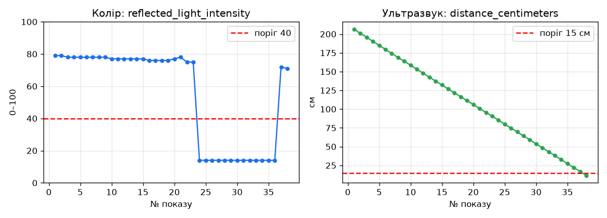

# Покази датчиків — робота 4

Датчики: **колір** (`ColorSensor(INPUT_1)`, `reflected_light_intensity`, 0–100) — головний для моєї місії (знайти колірну мітку й не заїхати в заборонену зону), і **ультразвуковий** (`UltrasonicSensor(INPUT_2)`, `distance_centimeters`, см) — для зупинки за 15 см до об'єкта.

Світ: власна сцена `kursova/scena/custom_world.json` (середовище № 2, ускладнення № 5): поле 4 × 4 м, три заборонені зони — темні плями 70 × 70 см. Робот стартував у центрі, розвернувся на 180° за гіроскопом і їхав на південь зі швидкістю 30 % через зону `(20, −150)`. Покази знімались за координатою GPS: новий рядок щоразу, коли робот проїхав ≥ 5 см (так числа не залежать від швидкості симулятора). `print` у кожній ітерації не використовував — результат збирається у список і друкується наприкінці.

Нерухомий датчик у Gears щоразу дає те саме число (шуму немає), тому заміри зроблено в русі.

| № | x, см | y, см | де був робот | колір, 0–100 | відстань, см |
|---|---|---|---|---|---|
| 1 | -0 | 6.8 | світла підлога | 79 | 206.6 |
| 2 | -0.1 | 1.7 | світла підлога | 79 | 200.8 |
| 3 | -0.2 | -3.7 | світла підлога | 78 | 195.8 |
| 4 | -0.2 | -9.1 | світла підлога | 78 | 190.3 |
| 5 | -0.3 | -14.5 | світла підлога | 78 | 184.9 |
| 6 | -0.4 | -19.8 | світла підлога | 78 | 179.6 |
| 7 | -0.4 | -25.3 | світла підлога | 78 | 174.2 |
| 8 | -0.5 | -30.7 | світла підлога | 78 | 168.9 |
| 9 | -0.6 | -35.8 | світла підлога | 78 | 163.7 |
| 10 | -0.6 | -41.1 | світла підлога | 77 | 158.5 |
| 11 | -0.7 | -46.3 | світла підлога | 77 | 153.2 |
| 12 | -0.7 | -51.5 | світла підлога | 77 | 147.9 |
| 13 | -0.8 | -56.9 | світла підлога | 77 | 142.6 |
| 14 | -0.9 | -62.1 | світла підлога | 77 | 137.3 |
| 15 | -0.9 | -67.4 | світла підлога | 77 | 132.2 |
| 16 | -1 | -72.6 | світла підлога | 76 | 126.9 |
| 17 | -1 | -77.8 | світла підлога | 76 | 121.6 |
| 18 | -1.1 | -83.1 | світла підлога | 76 | 116.5 |
| 19 | -1.1 | -88.2 | світла підлога | 76 | 111.3 |
| 20 | -1.2 | -93.5 | світла підлога | 77 | 106.1 |
| 21 | -1.2 | -98.7 | світла підлога | 78 | 100.8 |
| 22 | -1.3 | -103.8 | світла підлога | 75 | 95.7 |
| 23 | -1.3 | -108.9 | світла підлога | 75 | 90.5 |
| 24 | -1.4 | -114.1 | на забороненій зоні (темна пляма) | 14 | 85.4 |
| 25 | -1.5 | -119.5 | на забороненій зоні (темна пляма) | 14 | 79.9 |
| 26 | -1.5 | -124.7 | на забороненій зоні (темна пляма) | 14 | 74.7 |
| 27 | -1.6 | -130 | на забороненій зоні (темна пляма) | 14 | 69.6 |
| 28 | -1.6 | -135.3 | на забороненій зоні (темна пляма) | 14 | 64.3 |
| 29 | -1.7 | -140.5 | на забороненій зоні (темна пляма) | 14 | 59 |
| 30 | -1.8 | -145.7 | на забороненій зоні (темна пляма) | 14 | 53.8 |
| 31 | -1.8 | -151 | на забороненій зоні (темна пляма) | 14 | 48.5 |
| 32 | -1.9 | -156.2 | на забороненій зоні (темна пляма) | 14 | 43.3 |
| 33 | -2 | -161.5 | на забороненій зоні (темна пляма) | 14 | 38 |
| 34 | -2.1 | -166.7 | на забороненій зоні (темна пляма) | 14 | 32.7 |
| 35 | -2.1 | -172 | на забороненій зоні (темна пляма) | 14 | 27.4 |
| 36 | -2.2 | -177.3 | на забороненій зоні (темна пляма) | 14 | 22.2 |
| 37 | -2.3 | -182.6 | світла підлога за зоною, біля стіни | 72 | 16.9 |
| 38 | -2.4 | -187.9 | світла підлога за зоною, біля стіни | 71 | 11.5 |

Колір: найменший показ **14** (темна зона), найбільший **79** (світла підлога). Відстань: найменша **11.5 см** (біля стіни), найбільша **206.6 см**. Усього 38 показів.

Спостереження: підлога не дає одне число, а діапазон 71–79 (у першому, невдалому запуску на підлозі траплялись і 63); темна зона стабільно дає 14. Перехід між «полицями» 75 → 14 відбувається за один крок (5 см), на межі зони (y ≈ −114, зона починається з y = −115) — проміжних значень у цьому запуску немає.

## Графік

Файл `grafik.png`: зліва — показ кольору, справа — відстань ультразвуком, за віссю — номер показу. На графіку кольору видно дві «полиці»: світла підлога (71–79) і зона (14) з різким переходом; червона пунктирна лінія — обраний поріг 40. Ультразвук спадає рівно приблизно на 5,3 см за крок, бо кожен показ — це 5 см шляху до стіни.
